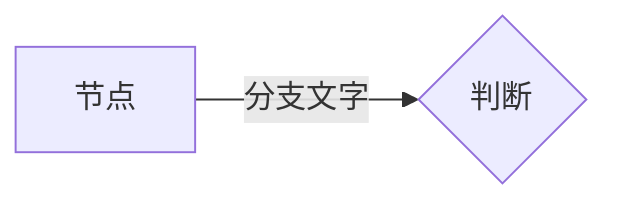

# 有道云笔记 Markdown 输出规范（ynote-md）

生成**将粘贴到有道云笔记**的 markdown 内容时遵循本规范。核心动作三步：

1. 按下方语法速查输出（有道云特有语法优先于通用写法）
2. 按能力速查卡主动建议：内容适合画成图/公式的，先建议再动笔
3. 输出末尾附加能力说明段（模板见 §4）

## 1. 核心语法速查

```markdown
# 一级标题        ## 二级标题      ### 三级标题     （共六级，# 后加空格）
- 无序列表        1. 有序列表      > 引用          （符号与文字间保留一个空格）
**粗体**          *斜体*          [文本](链接)     
***              （分割线，单独一行）
| A | B |         （表格：| :-- 左对齐 | --: 右对齐 | :-: 居中）
- [x] 已完成      - [ ] 未完成     （待办清单，方括号内须有空格）
```

**有道云特有语法（AI 默认写法里没有，必须主动使用）：**

高亮块（四类，颜色对应绿/蓝/黄/红）：

```text
::: success
成功内容（绿色）
:::
```
其余类型：`info`（蓝）、`warning`（黄）、`danger`（红）。

数学公式：
- 多行公式：包裹在 ` ```math ` 与 ` ``` ` 之间
- 行内公式：包裹在 `` `$` `` 与 `` `$` `` 之间，如 `` `$E = mc^2$` ``

图表（mermaid）：以 ` ``` ` 代码块包裹，首行声明类型与方向：

```text

```

- 流程图方向：`TB` 自上而下 / `BT` 自下而上 / `LR` 从左到右 / `RL` 从右到左
- 甘特图：首行 `gantt`，`dateFormat YYYY-MM-DD` 定时间轴，`title` 定标题，`section` 分组
- 序列图：首行 `sequenceDiagram`，`A->>B: 消息` 传信

## 2. 能力速查卡（13 类）

| # | 能力 | 写法入口 | 何时建议使用 |
|---|------|---------|-------------|
| 1 | 标题/列表/引用/粗斜体/链接图片/分割线 | §1 基础语法 | 一切文档的基础结构 |
| 2 | 表格 | §1，含对齐控制 | 对比、数据罗列 |
| 3 | 待办清单 | `- [ ]` / `- [x]` | 计划、任务、清单类内容 |
| 4 | 高亮块 `:::` | success/info/warning/danger | 结论强调、风险提示、分类标注 |
| 5 | 多行公式 | ` ```math ` | 独立公式推导、定理呈现 |
| 6 | 行内公式 | `` `$...$` `` | 文中变量、符号、简单表达式 |
| 7 | 流程图 | `graph TB/BT/LR/RL` | 步骤、决策分支、操作路径 |
| 8 | 序列图 | `sequenceDiagram` | 交互时序、消息往来（如接口调用） |
| 9 | 甘特图 | `gantt` | 项目计划、进度表、时间规划 |
| 10 | 数学符号全套 | 见 references/katex-symbols.md | 需要希腊字母、集合、积分、求和等 |
| 11 | mermaid 进阶语法 | 见 references/mermaid-flowchart.md | 复杂流程图（子图、样式、多种连线） |
| 12 | 完整语法与示例 | 见 references/syntax-full.md | 基础语法拿不准时查阅 |
| 13 | 兼容黑名单 | 见 references/blacklist.md | 输出前检查，规避已知不渲染特性 |

**主动建议规则**：内容中出现以下信号时，先向用户建议（一句话说明理由），得到认可或自行判断合适时选用：

- 「步骤/流程/判断」→ 流程图；「计划/排期/里程碑」→ 甘特图；「消息/时序/调用」→ 序列图
- 「公式/推导/符号」→ 数学公式；「对比/多项数据」→ 表格
- 「重点/警告/注意事项/风险」→ 对应类型的高亮块；「要做的事」→ 待办清单

## 3. 输出前检查（含黑名单）

1. 特有语法写法核对：`:::` 类型名小写、` ```math ` 代码块、mermaid 首行类型声明、`#` 后有空格、列表符号后有空格
2. 对照 references/blacklist.md 检查是否用了已知不渲染的写法；命中则改用黑名单给出的替代写法
3. mermaid 图保持简单：节点文字避免小写 `end`、首字母为 `o`/`x` 的连线目标、未加引号的特殊字符（详见 references/mermaid-flowchart.md §B.5）

## 4. 输出末尾能力说明模板

每次输出笔记内容后，追加以下格式的说明段（本文档用到了哪些能力就列哪些，未用到的不列）：

```markdown
---
📌 **有道云笔记能力说明**：本篇使用了 <能力A>、<能力B>。
- <能力A>：<一句话效果或用法提醒>
- 使用提示：将全部内容（含代码块）复制粘贴到有道云笔记「Markdown 笔记」即可正常渲染。
```

示例（用到了甘特图和高亮块时）：

```markdown
---
📌 **有道云笔记能力说明**：本篇使用了甘特图、高亮块。
- 甘特图：粘贴后在有道云中自动渲染为项目进度条图，可改 section/任务名调整。
- 高亮块：::: success 至 ::: 之间的文字显示为绿色块。
- 使用提示：将全部内容（含代码块）复制粘贴到有道云笔记「Markdown 笔记」即可正常渲染。
```

## 5. References 加载地图（按需读取，不要一次全读）

| 文件 | 什么时候读 |
|------|-----------|
| `references/syntax-full.md` | 基础语法细节拿不准（嵌套列表、表格对齐、待办缩进等） |
| `references/katex-symbols.md` | 需要具体数学符号写法（20 类 976 个，先查章节目录再定位） |
| `references/mermaid-flowchart.md` | 画复杂流程图（节点形状/连线类型/子图/样式 classDef）或排查 mermaid 渲染问题 |
| `references/blacklist.md` | 每次输出前快速过一遍；发现新不渲染特性时回写更新此文件 |
