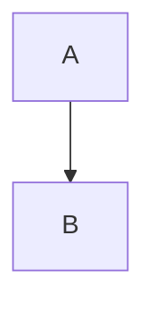
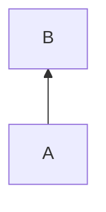
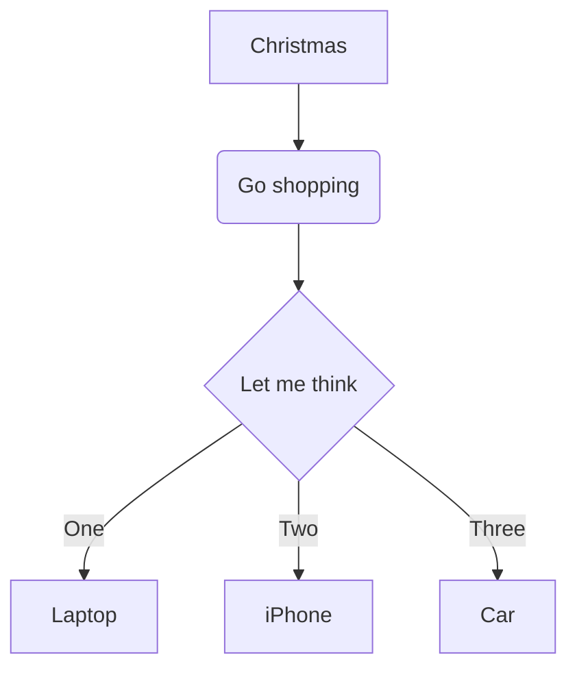
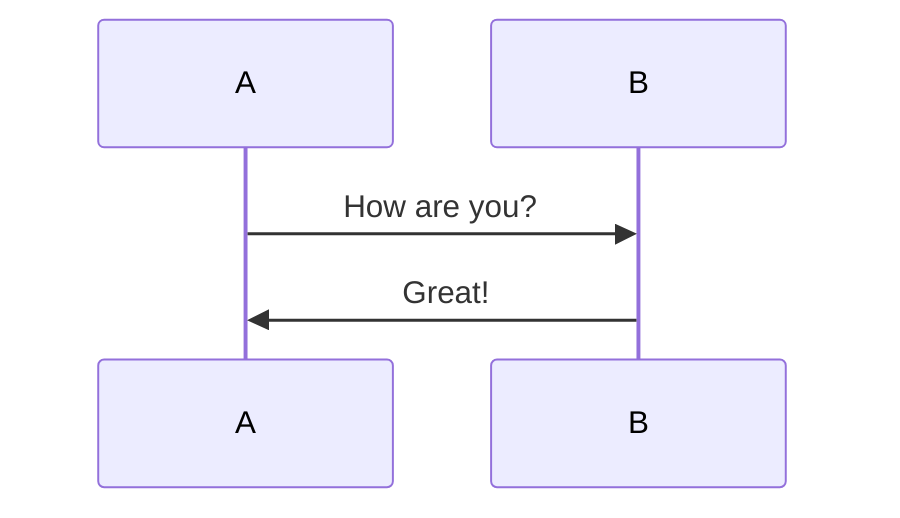

> 复用自 2026-11-19 解析的《有道云笔记-Markdown使用指南-纯文本版》（来源：有道云笔记官方帮助中心 advance_markdown.html，全部 30 张配图已识别转录为文字）。
> 使用方式：SKILL.md 的速查已覆盖高频写法；本文件供基础语法细节拿不准时查阅。

# 👨‍💻 Markdown笔记使用指南（有道云笔记帮助中心 · 纯文本版）

> 来源：[有道云笔记帮助中心 - Markdown笔记使用指南](https://note.youdao.com/help-center/advance_markdown.html)
> 说明：本版本已将原网页中的全部配图识别并转录为文字/代码，无任何图片依赖。

## 什么是 Markdown？

Markdown是一种轻量级的「标记语言」，通常为程序员群体所用，目前它已是全球最大的技术分享网站 GitHub 和技术问答网站 StackOverFlow 的御用书写格式。

有道云笔记内置Markdown编辑器和使用指南，非技术类笔记用户，千万不要被「标记」、「语言」吓到，Markdown的语法十分简单，常用的标记符号不超过十个，用于日常写作记录绰绰有余，不到半小时就能完全掌握。就是这十个不到的标记符号，却能让人优雅地沉浸式记录，专注内容而不是纠结排版，达到「心中无尘，码字入神」的境界。

## Markdown笔记使用 Tips

### 实时同步预览，所看即所得

我们将笔记编辑界面一分为二，左边为编辑区，右边为预览区，两区滚动条同步。在编辑区的操作能够实时反映在预览区，方便及时调整和查看最终版面效果。

> 界面示意：顶部标题为「无标题Markdown.md」，工具栏含加粗/斜体/删除线/下划线/高亮、h1~h6、引用、列表、待办、链接、图片、代码、表格、公式等按钮；左侧编辑区与右侧预览区同步显示。

### 工具栏内置Markdown语法，方便新手学习

编辑页面顶端的工具栏有对应代码，如果你是一个不熟悉Markdown语法的新手，可以先尝试用工具栏辅助操作。也可以在网上搜索「Markdown语法指南」进行学习。

当然，如果你觉得工具栏太打扰，点击下方分界条即可隐藏工具栏，切换到极简编辑环境。

### 实时云端保存

Markdown模式继承了有道云笔记的优良传统，你每一次击键的内容都会实时保存在云端，无需担心浏览器崩溃、设备没电、突然断网等情况。对于写作者来说，更是再也不用担心因为各种原因痛失文稿的情况了。

### 界面大小可点击分界条调整

点击"1"处（工具栏与编辑区之间的横向分界条），工具栏收起；

点击"2"处（编辑区与预览区之间的纵向分界条），右侧预览区收起。

> 调整后效果：界面只保留左侧纯代码编辑区，工具栏与预览区均已隐藏。

## 桌面端7.1.8版本功能更新

在有道云笔记桌面端7.1.8版本更新后，在Markdown笔记原有能力的基础上，我们做了几项**重磅升级**。

### 一、新增【所见即所得】编辑模式

新增了**所见即所得**的编辑界面，点击界面右上角的切换按钮即可选择切换。

> 界面示意：点击右上角切换按钮后弹出三个选项——「分屏编辑」「所见即所得」「预览模式」。

### 二、新增行编辑菜单

在所见即所得的编辑界面，编辑文字内容时，选中的文字上方可生成悬浮工具栏，支持快速为目标内容添加格式。

> 界面示意：选中文字「Markdown笔记能力」后，上方浮出悬浮工具栏，包含：**加粗（B）、斜体（I）、删除线（S）、代码（<>）、链接** 五个按钮。

### 三、新增斜杠唤起菜单

使用 `/` （斜杠）快速唤起工具栏，快速选择添加相关类型的内容。

> 界面示意：键入 `/` 后弹出菜单，包含：Large Heading（一级标题）、Medium Heading（二级标题）、Small Heading（三级标题）、Bullet List（无序列表）、Ordered List（有序列表）、Task List（待办列表）、Image（图片）等选项，底部有「/ 输入关键词筛选…」搜索框。

### 四、新增块编辑菜单

可点击目标内容左侧的编辑块，在弹出的菜单中快速选择。

> 界面示意：点击内容块左侧的拖拽手柄后弹出菜单，选项包括：Text（文本）、Heading 1、Heading 2、Heading 3、Blockquote（引用）、Code（代码）。

### 五、支持4类高亮块

在分屏编辑界面，可以使用以下语法实现高亮块格式。4类高亮块类型分别是：**成功、信息、警告、危险**，对应绿色、蓝色、黄色和红色高亮块。

语法与渲染效果对照：

```text
::: success
成功
:::
```
→ 渲染为绿色高亮块，块内文字「成功」

```text
::: info
信息
:::
```
→ 渲染为蓝色高亮块，块内文字「信息」

```text
::: warning
警告
:::
```
→ 渲染为黄色高亮块，块内文字「警告」

```text
::: danger
危险
:::
```
→ 渲染为红色高亮块，块内文字「危险」

### 六、表格快速编辑

在所见即所得界面，创建表格后，可选中表格，在弹出工具栏点击对应选项快速完成以下操作：

- 向左、右添加列（对应工具栏 `<` `>` 按钮）
- 向上、下添加行（对应工具栏 `˅` 按钮）
- 左对齐、右对齐、居中（对应三种对齐图标按钮）
- 删除行、列（对应垃圾桶图标按钮）

## 「简明版」有道云笔记Markdown指南

### 0 标题

标题是每篇文章必备而且最常用的格式。

在Markdown中，如果想将一段文字定义为标题，只需要在这段文字前面加上 `#`，再在 `#` 后加一个空格即可。还可增加二、三、四、五、六级标题，总共六级，只需要增加 `#`，增加一个 `#`，标题字号相应降低一级。

语法示例：

```markdown
# 一级标题
## 二级标题
### 三级标题
#### 四级标题
```

渲染效果：依次显示字号递减的「一级标题」「二级标题」「三级标题」「四级标题」。

### 1 列表

列表格式也很常用，它可以让你的文稿变得井井有条。

在 Markdown 中，你只需要在文字前面加上 `-` 就可以了；如果你希望是有序列表，在文字前面加上 `1.` `2.` `3.` 即可。

> 注：`-`、`1.` 和文字之间要保留一个字符的空格。

语法示例：

```markdown
##### 无序列表
- 列表1
    - 列表1.1
    - 列表1.2
- 列表2
- 列表3

##### 有序列表
1. 列表1
    1. 列表1.1
    2. 列表1.2
2. 列表2
3. 列表3
```

渲染效果：
- 无序列表：列表1（下级圆圈符号子项：列表1.1、列表1.2）、列表2、列表3
- 有序列表：1. 列表1（下级罗马数字子项 i. 列表1.1、ii. 列表1.2）、2. 列表2、3. 列表3

### 2 引用

如果你需要在文稿中引用一段别处的句子，那么就要用到「引用」格式。

在引用文字前加上 `>` 并与文字保留一个字符的空格，即可。

语法示例：

```markdown
###### 引用
> 记录，成为更好的自己。——有道云笔记
```

渲染效果：标题「引用」下方显示带左侧竖线的引用块：「记录，成为更好的自己。——有道云笔记」

### 3 粗体和斜体

Markdown 的粗体和斜体也非常简单：

- 用两个 `*` 包含一段文本就是粗体的语法
- 用一个 `*` 包含一段文本就是斜体的语法

语法示例：

```markdown
*这是斜体*
**这是粗体**
#### 注意：符号与文本之间无须空格
```

渲染效果：斜体的「这是斜体」、粗体的「这是粗体」。

### 4 链接与图片

**链接**：在 Markdown 中，插入链接只需要使用：

```markdown
[显示文本](链接地址)
```

**图片**：在 Markdown 中，插入图片只需要使用：

```markdown

```

> 注：插入图片的语法和链接的语法很像，只是前面多了一个 `!`。

语法示例：

```markdown
#### 插入链接
[有道云笔记官网](http://note.youdao.com/)

#### 插入图片

```

渲染效果：显示蓝色可点击链接「有道云笔记官网」，以及有道云笔记的图标图片。

### 5 分割线

分割线的语法只需要另起一行，连续输入三个星号 `***` 即可分割两段文字内容。

语法示例：

```markdown
#### 分割线

这是第一段内容
***
这是第二段内容
```

渲染效果：两段文字之间出现一条水平分割线。

### 6 表格

当你需要在Markdown文稿中键入表格，代码如下。

**简写形式：**

```markdown
header 1 | header 2
---|---
row 1 col 1 | row 1 col 2
row 2 col 1 | row 2 col 2
```

**完整形式（含对齐控制）：**

```markdown
| Item      |   Value  | Qty  |
| :-------- | --------:| :--: |
| Computer  | 1600 USD |  5   |
| Phone     |  12 USD  |  12  |
| Pipe      |   1 USD  | 234  |
```

对齐说明：分隔线中 `:--` 表示左对齐、`--:` 表示右对齐、`:-:` 表示居中。

渲染效果：

| Item | Value | Qty |
| :--- | ----: | :-: |
| Computer | 1600 USD | 5 |
| Phone | 12 USD | 12 |
| Pipe | 1 USD | 234 |

> 小技巧：「表格」语法相对复杂，容易忘记。点击编辑框上方工具栏的「表格」图标，左边编辑区便会自动出现表格相应代码，将代码替换成相应文本即可。熟悉语法之后，建议尽量自己键入代码。

### 7 数学公式

#### 7.1 多行公式

多行公式包裹在 ` ```math ` 和 ` ``` ` 内，例如：

````markdown
```math
e^{i\pi} + 1 = 0
```
````

渲染效果：欧拉公式 e^iπ + 1 = 0（渲染为标准数学排版）。

#### 7.2 行内公式

行内公式包裹在 `` `$` `` 和 `` `$` `` 内，例如：

```markdown
`$E \neq mc^2$`是一个行内公式
```

渲染效果：行内显示 E ≠ mc²。

#### 7.3 常用符号

**（1）导数符号**

```markdown
`$f'(x)$`
```
渲染效果：f′(x)

**（2）向量**

```markdown
`$\vec {a}$` `$\overrightarrow {P_0P_1}$`
```
渲染效果：a⃗（带上箭头的a）、P₀P₁⃗（带上箭头的P₀P₁）

**（3）希腊字母**

```markdown
`$\alpha$` `$\Alpha$` `$\beta$` `$\Delta$` `$\lambda$`
```
渲染效果：α、Α、β、Δ、λ

**（4）偏导数**

```markdown
`$\partial$`
```
渲染效果：∂

**（5）加减乘除**

```markdown
`$a+b$` `$a-b$` `$a \times b$` `$a \div b$`
```
渲染效果：a+b、a−b、a×b、a÷b

**（6）上下标**

```markdown
`$x^n$` `$x_n$`
```
渲染效果：xⁿ、xₙ

**（7）集合**

```markdown
`$(0, 10) \cap (-2, 6)$` `$(-\infty,0) \cup (0,+\infty)$` `$k \in \bf {Z}$` `$D \subset R$`
```
渲染效果：(0,10)∩(−2,6)、(−∞,0)∪(0,+∞)、k∈**Z**、D⊂R

**（8）积分**

```markdown
`$\int _{-\infty} ^{+\infty} e^x dx$`
`$\iint \limits _D f(x,y) dxdy$`
```
渲染效果：从−∞到+∞的积分 eˣdx；区域D上的二重积分 f(x,y)dxdy

**（9）求和**

```markdown
`$\sum \limits _{i=1} ^n f(x)$`
`$\sum \limits _{\substack {0<i<m \\ 0<j<n}} f(x)$`
```
渲染效果：i=1到n的求和 Σf(x)；双下标条件求和 Σf(x)

**（10）求积**

```markdown
`$\prod \limits _{k=1} ^n a_k$`
```
渲染效果：k=1到n的连乘 Πaₖ

**（11）分数**

```markdown
`$\dfrac{a}{b}$`
`$\cfrac{a}{1 + \cfrac{1}{b}}$`
```
渲染效果：上下结构的分数 a/b；嵌套连分数 a/(1+1/b)

**（12）比较**

```markdown
`$x=y$` `$x \ne y$` `$x>y$` `$x \le y$` `$x \ge y$` `$x \approx y$`
```
渲染效果：x=y、x≠y、x>y、x≤y、x≥y、x≈y

**（13）矩阵**

````markdown
```math
\begin{vmatrix}
   a & b \\
   c & d
\end{vmatrix}
```
````

渲染效果：带竖线的二阶行列式 |a b; c d|。

> 有道云笔记使用的公式语法是 KaTeX。官方文档 [Supported Functions](https://katex.org/docs/supported.html) 中的全部符号写法已集成至本文档 **附录 A**。

---

如上8大格式是写作文稿时最常使用的。当然，有道云笔记的Markdown还能支持制作待办事项，书写流程图、序列图、甘特图，书写数学公式等。原文展示了一个用Markdown甘特图写的项目计划时间表（见下文甘特图一节的完整示例）。

## 「进阶版」有道云笔记Markdown指南

"进阶版"有道云笔记Markdown指南，教你如何进一步掌握待办、清单、流程图和甘特图。

### 0 待办和清单

待办事项和清单在日常工作、生活中经常被使用。

在Markdown中，你只需要在待办的事项文本或者清单文本前加上 `- [ ]`、`- [x]` 即可：

- `- [ ]` 表示未完成
- `- [x]` 表示已完成

> 注：键入字符与字符之间都要保留一个字符的空格。

语法示例：

```markdown
### To-do List

- [x] 已完成项目1
    - [x] 已完成事项1
    - [x] 已完成事项2
- [ ] 待办事项1
- [ ] 待办事项2
```

渲染效果：

- [x] 已完成项目1
    - [x] 已完成事项1
    - [x] 已完成事项2
- [ ] 待办事项1
- [ ] 待办事项2

（已完成项显示为灰色勾选框 ☑，未完成项显示为空心勾选框 ☐）

### 1 流程图

在Markdown中，一段流程图语法，以 ` ``` ` 开头，以 ` ``` ` 结尾。

在 ` ``` ` 后另起一行，书写 `graph XX`，用以确定将要绘制的流程图及其类型（XX表示流程图类型）。

流程图分为竖向和横向两大类，竖向包括自上而下和自下而上两种顺序，横向包括从右到左和从左到右两种顺序。其对应语法分别为：`graph TB` / `graph BT` / `graph RL` / `graph LR`。

- `TB` - top bottom（自上而下）
- `BT` - bottom top（自下而上）
- `RL` - right left（从右到左）
- `LR` - left right（从左到右）

**四种方向的语法与渲染效果对照：**

自上而下的顺序：

````markdown

````

渲染效果：节点 A 在上、节点 B 在下，箭头由 A 指向 B。

自下而上的顺序：

````markdown

````

渲染效果：节点 B 在上、节点 A 在下，箭头由 A 指向 B。

从右到左的顺序：

````markdown

````

渲染效果：节点 B 在左、节点 A 在右，箭头由 A 指向 B。

从左到右的顺序：

````markdown

````

渲染效果：节点 A 在左、节点 B 在右，箭头由 A 指向 B。

**具体案例（Christmas 购物流程图）：**

````markdown

````

渲染效果：矩形节点 Christmas → 圆角节点 Go shopping → 菱形判断节点 Let me think，再经三条分支（One/Two/Three）分别指向矩形节点 Laptop、iPhone、Car。

**① 对框线形状的调整：**

````markdown

````

````markdown

````

````markdown

````

对照说明：`[文本]` 渲染为直角矩形节点；`((文本))` 渲染为圆形节点；`{文本}` 渲染为菱形节点。

**② 对箭头的调整：**

````markdown

````

````markdown

````

````markdown

````

对照说明：`---` 渲染为无箭头实线（A—B）；`-->` 渲染为带箭头实线（A→B）；`-->|文本|` 渲染为带箭头且线上标注文字的连线（A—插入文本→B）。

> 更详细的流程图语法（节点形状、连线类型、子图、样式等），官方文档 [Flowchart](https://mermaid.js.org/syntax/flowchart.html)（即 [mermaid 官方仓库](https://github.com/mermaid-js/mermaid) 所指文档）已集成至本文档 **附录 B**。

**补充（序列图语法示例，来自原文界面截图）：**

````markdown

````

渲染效果：A、B 两条生命线之间，A 向 B 发送消息「How are you?」，B 向 A 回复「Great!」。

### 2 甘特图

我们在工作中用甘特图作计划进度表、项目进度表再合适不过了。

与流程图一样，Markdown中，甘特图的语法也是以 ` ``` ` 开头，以 ` ``` ` 结尾。在 ` ``` ` 后另起一行，书写 `gantt`，用以确定将要绘制的是甘特图。

标题的书写语法：

```text
```
gantt
dateFormat  YYYY-MM-DD
title 产品计划表
```

**`dateFormat YYYY-MM-DD` 规定了时间轴，`title`（标题文本）表示甘特图标题。**

如需按项目进行划分，需键入 `section`，空一个字符，再输入项目名称的文本（一个section和另一个section之间要空行）。每个大项目将拆解为若干个小任务，只需在section之后另起一行，直接输入小项目名称即可。

**完整示例（产品计划表甘特图）：**

````markdown
```
gantt
dateFormat  YYYY-MM-DD
title 产品计划表
section 初期阶段
明确需求 :2016-03-01, 10d
section 中期阶段
跟进开发 :2016-03-11, 15d
section 后期阶段
走查测试 :2016-03-20, 9d
```
````

渲染效果：标题为「产品计划表」的横向时间条图，时间轴为 3/7、3/14、3/21、3/28；三个分组条带分别是「初期阶段」（浅紫色，任务条：明确需求）、「中期阶段」（任务条：跟进开发）、「后期阶段」（浅黄色，任务条：走查测试），三条任务条按时间依次错开排布。

---
